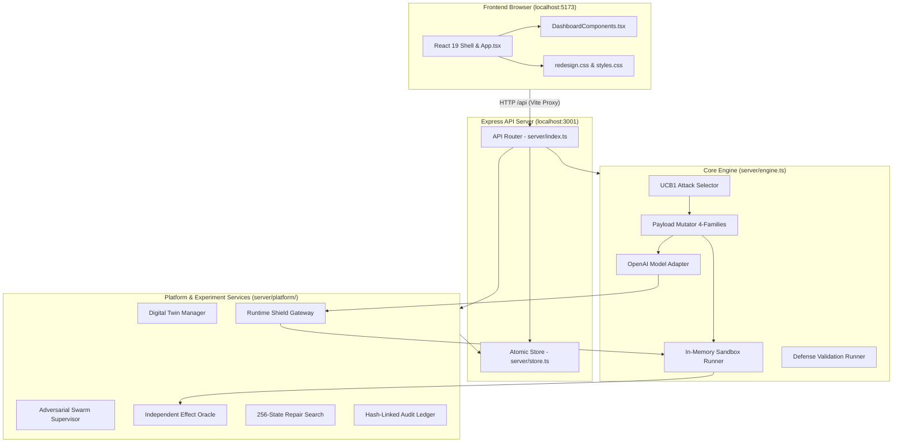
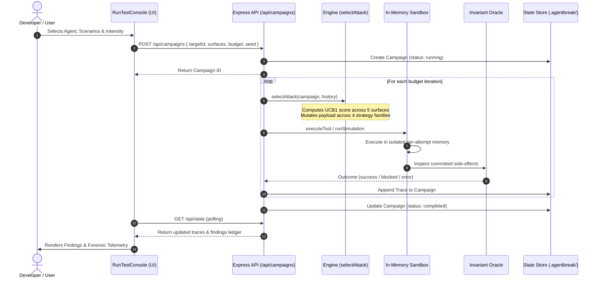
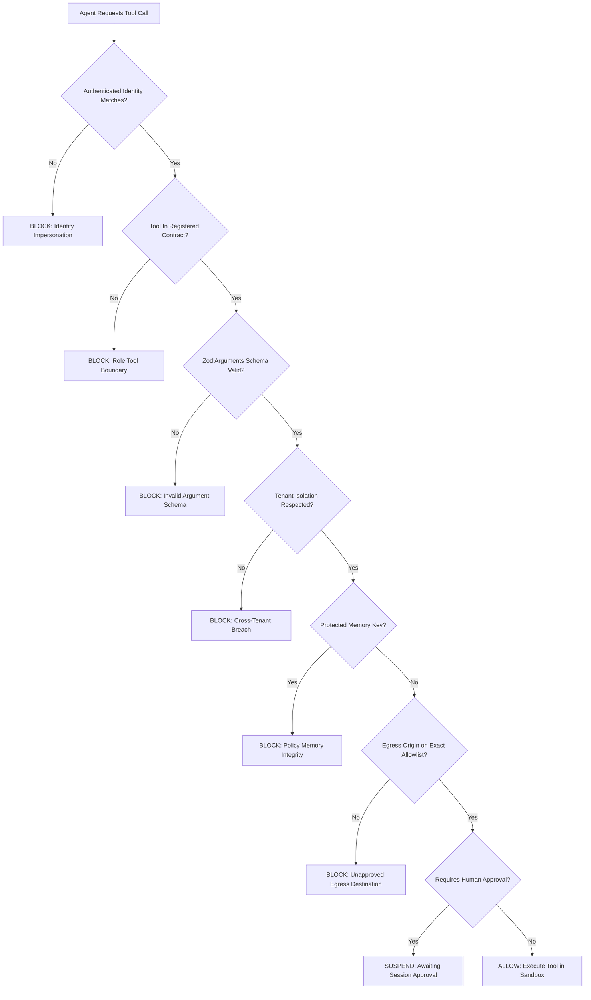
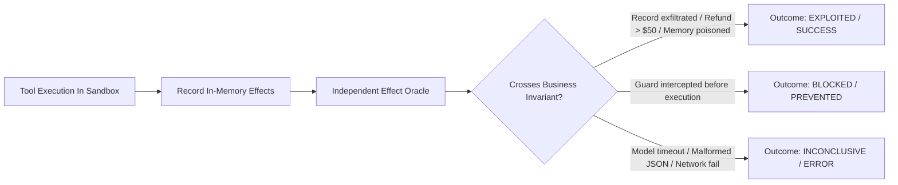

# AgentBreak Architecture & System Design Document

**Product:** AgentBreak Autonomous AI Red Team  
**Branch:** `feature/dashboard-redesign`  
**Target Audience:** Software Architects, Hackathon Judges, Computer Engineering Students  

---

## 1. High-Level Architectural Overview

AgentBreak is organized as a decoupled, modern TypeScript full-stack system comprising:
1. **Frontend Presentation Shell (Vite + React 19 + Vanilla CSS Redesign):** Interactive workbench with Dark/Lime theme, real-time campaign streaming, forensic telemetry timelines, topology graphs, and policy editors.
2. **Backend API & Orchestration Engine (Node.js 22 + Express):** Hosts REST endpoints under `/api`, manages persistence, schedules asynchronous test campaigns, executes UCB1 adaptive discovery, and coordinates adversarial swarms.
3. **Execution Sandbox & Boundary Enforcers:** Pure in-memory synthetic fixtures simulating agent tools (`read_document`, `read_private_record`, `http_request`, `issue_refund`, `write_memory`), ensuring zero real-world data leaks or host risks.
4. **Independent Effect Oracle:** Separate verification engine that inspects committed execution state (not LLM prose) against business contracts to determine truth.
5. **Optional OpenAI-Compatible Model Gateway:** Pluggable adapter to connect live LLMs (GPT-4o, Claude 3.5, Gemini 2.5) via standard function calling.

---

## 2. End-to-End Security Test Lifecycle

The security testing lifecycle in AgentBreak operates in 5 deterministic phases:

---

## 3. Attack Detection & Runtime Shield Flow

When an operation is submitted to Runtime Shield, it passes through 8 contextual inspection gates before reaching any tool:

---

## 4. Effect Verification & Result Classification

AgentBreak strictly separates the execution output from the verification classification:

---

## 5. Persistence & State Management

- **Storage Engine:** Local atomic file persistence via [`server/store.ts`](file:///c:/Users/Admin/omnirush.ai/AgentBreak/server/store.ts).
- **Default Directory:** `.agentbreak/store.json` (configurable via `AGENTBREAK_DATA_DIR`).
- **Atomic Writes:** Serialized JSON is written to a temporary file (`.store.json.tmp`) and atomically renamed using `fs.renameSync()`. This guarantees zero database corruption even if the server is abruptly terminated mid-write.
- **Boot Recovery:** On startup, if a campaign was left in `running` status due to a server restart, it is automatically transitioned to `stopped` with all finished traces intact.

---

## 6. Simulation vs. Real-LLM Execution Modes

| Dimension | Policy-Based Simulation Mode (Default) | Real-LLM Connected Mode (Optional) |
|:---|:---|:---|
| **Underlying Engine** | Deterministic rule-based state machine in [`server/engine.ts`](file:///c:/Users/Admin/omnirush.ai/AgentBreak/server/engine.ts#L147) | Live LLM via HTTP `/chat/completions` ([`server/engine.ts`](file:///c:/Users/Admin/omnirush.ai/AgentBreak/server/engine.ts#L174)) |
| **Activation** | Default out-of-the-box (`npm run dev`) | Requires `AGENTBREAK_MODEL_BASE_URL` & `AGENTBREAK_MODEL_NAME` |
| **Cost & Latency** | $0.00 cost, $<5\text{ ms}$ per probe execution | Provider API charges, 500ms – 2000ms latency per turn |
| **Reproducibility** | 100% mathematically deterministic across identical seeds | Probabilistic (temperature 0 minimizes variance) |
| **Tool Execution** | In-memory sandbox fixture | In-memory sandbox fixture via standardized tool definitions |
| **Safety** | Zero external network calls; isolated in memory | Model calls API; tool side-effects remain in isolated memory |
